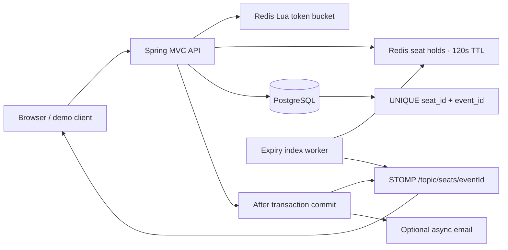

<div align="center">

# TickIt

### One seat. One booking. Live updates for everyone.

A real-time ticket booking MVP built with **Java 21**, **Spring Boot**, **PostgreSQL**, and **Redis**.

[](https://github.com/naman771/TickIt/actions/workflows/ci.yml)


[Quick start](#quick-start) · [Architecture](#architecture) · [API reference](docs/API.md) · [Demo guide](docs/DEMO.md)

</div>


TickIt models the hardest part of a flash sale: multiple people trying to book the same seat. Redis gives each seat a short-lived hold, PostgreSQL enforces one confirmed booking per seat and event, and WebSockets keep connected seat maps current.

## What you can demonstrate

- Browse three seeded events with 132 seats and a responsive interactive seat map.
- Hold a seat for 120 seconds, release it, or confirm a booking.
- Watch `HELD`, `FREE`, and `BOOKED` changes in another browser window.
- Observe HTTP `429` responses when a burst exhausts a Redis token bucket.
- Run a 50-thread contention test that asserts exactly one successful booking.
- Verify rollback safety and database uniqueness independently of Redis.

**MVP scope:** the user picker simulates three users. Authentication, payments, and production deployment are future work. Email is optional and disabled by default.

## Quick start

### Docker Compose

Install Docker with Compose, then run:

```bash
git clone git@github.com:naman771/TickIt.git
cd TickIt
docker compose up --build -d
```

Open **[localhost:8080](http://localhost:8080)**. The first build downloads Maven dependencies; Compose waits for PostgreSQL and Redis health checks before starting the application. Flyway creates the schema, then the application seeds demonstration data into an empty database.

```bash
docker compose logs -f app
docker compose down
```

If local services already use the default ports:

```bash
APP_PORT=8081 POSTGRES_PORT=5433 REDIS_PORT=6380 docker compose up --build -d
```

Database data persists in Compose volumes. `docker compose down` keeps those volumes. To deliberately reset the disposable demo data, use `docker compose down -v` before starting again.

### Local Java development

Prerequisites: JDK 21, Maven 3.9+, PostgreSQL, and Redis. The Compose configuration uses PostgreSQL 16 and Redis 7; the local validation environment used PostgreSQL 18.

```bash
createdb tickit
export DB_USER="$(whoami)"
# Set DB_PASS if your PostgreSQL installation requires a password.
mvn spring-boot:run
```

Redis must be listening on `localhost:6379`. Override the connection settings below when needed.

## Architecture



1. A write request passes a per-IP token bucket: **20 tokens**, refilling at **5 tokens/second**. An optional `X-User-Id` header adds a demo user bucket; it is not authentication. The application uses the socket peer IP and does not trust arbitrary forwarded-IP headers.
2. A Redis Lua script atomically acquires a hold and records its deadline in a sorted set. The same owner can retry without extending the original TTL. Competing owners receive `409`.
3. Checkout validates the hold, user, and seat/event relationship. PostgreSQL's `UNIQUE (seat_id, event_id)` constraint arbitrates concurrent inserts. `@Version` supports optimistic locking for updates to an existing booking; it does **not** replace the uniqueness constraint.
4. Only after the database transaction commits does the service release the owner's hold, broadcast `BOOKED`, and dispatch the optional email. Notification failures are logged and do not turn a committed booking into a failed HTTP response.
5. An expiry worker checks a bounded batch from the sorted-set index every second and broadcasts expired seats. Browsers also reconcile against the seat API every five seconds and after reconnecting to recover missed messages.

## API at a glance

| Method | Endpoint | Purpose |
|---|---|---|
| GET | `/api/events` | List events |
| GET | `/api/events/{id}` | Event details |
| GET | `/api/events/{id}/seats` | Current seat map |
| POST | `/api/holds` | Acquire or retry a hold |
| DELETE | `/api/holds/{eventId}/{seatId}?userId=1` | Release the specified owner's hold |
| POST | `/api/bookings` | Confirm an existing hold |
| GET | `/api/bookings/user/{userId}` | Demo booking history |
| GET | `/actuator/health` | Application health |

Hold and booking bodies use `{"eventId":1,"seatId":3,"userId":1}`. See the [API reference](docs/API.md) for a complete example and status codes.

## Tests and concurrency demonstration

Tests use a separate PostgreSQL database and **Redis logical database 15**. Use a disposable Redis instance for tests, rather than one hosting unrelated workloads in that database.

```bash
createdb tickit_test
export DB_USER="$(whoami)"
mvn verify
mvn test -Dtest=BookingConcurrencyTest
```

`TEST_DATABASE_URL` overrides the test database connection. CI provisions PostgreSQL and Redis service containers, runs the suite, validates the Compose file, and builds the Docker image.

The verified suite contains **19 tests**, including Redis hold ownership, token refill, REST validation, transaction rollback, notification failure, hold expiration, and direct competing database inserts. The 50-thread test checks **1 success, 49 rejected attempts, and exactly 1 database row**. See [validation details](docs/VALIDATION.md).

With the app running, demonstrate HTTP contention:

```bash
./scripts/concurrency_benchmark.sh http://localhost:8080 1 50
```

This script uses the three real seeded users, discovers the actual hold owner, confirms that owner's booking, and checks the final seat state. Multiple `200` responses can belong to the **same** owner because retries are idempotent. The exact `409`/`429` split depends on timing and bucket history; it is not a fixed benchmark result.

## Configuration

| Variable | Default | Purpose |
|---|---|---|
| `DB_HOST` / `DB_PORT` | `localhost` / `5432` | PostgreSQL address |
| `DB_NAME` | `tickit` | Application database |
| `DB_USER` / `DB_PASS` | `tickit` / empty | Local database credentials; override for your machine |
| `REDIS_HOST` / `REDIS_PORT` | `localhost` / `6379` | Redis address |
| `SERVER_PORT` | `8080` | Local application port |
| `TEST_DATABASE_URL` | `jdbc:postgresql://localhost:5432/tickit_test` | Test database |
| `EMAIL_ENABLED` | `false` | Enable optional SMTP delivery |
| `SMTP_HOST` / `SMTP_PORT` | `smtp.gmail.com` / `587` | SMTP address |
| `SMTP_USER` / `SMTP_PASS` | empty | SMTP credentials |
| `EMAIL_FROM` | `noreply@tickit.live` | Sender address |

Spring properties can also be overridden through standard environment variables, for example `APP_SEAT_HOLD_TTL_SECONDS=120`. Compose supplies its own demo database credentials. Keep credentials out of Git; `.env` files are ignored.

## Repository layout

```text
src/main/java/com/tickit/
  config/          MVC, Redis, WebSocket, async executor
  controller/      Event, hold, booking endpoints
  dto/             Request, response, live-update payloads
  exception/       HTTP error mapping
  init/            Demonstration seed data
  model/           JPA entities
  repository/      Spring Data repositories
  service/         Booking, holds, expiry, rate limiting, email
src/main/resources/
  db/migration/    Flyway schema
  scripts/         Atomic Redis Lua operations
  static/          Browser UI and vendored WebSocket clients
src/test/          Integration and concurrency regression tests
docs/              API, demo guide, validation evidence
.github/workflows/ Build, tests, container validation
```

## Deliberate MVP boundaries

- Single application instance with Spring's in-memory STOMP broker; horizontal deployment needs a shared broker and durable event delivery.
- Simulated user IDs are client supplied. Owner checks prevent accidental cross-user releases, but are not an authorization boundary. Add JWT authentication before exposing the app publicly.
- No payment processing, cancellations/refunds, or booking idempotency keys. A retry after an already-confirmed booking may return `409` or `410`; inspect booking history to reconcile.
- SMTP is best-effort through a bounded async executor. A transactional outbox and retry worker are needed for durable delivery.
- Redis scripts target standalone Redis; the expiry index is not designed for Redis Cluster hash-slot routing.
- Container execution is defined in Compose and checked in CI; Docker was unavailable in the local validation environment.

The interface includes local event artwork and vendored SockJS/STOMP clients, so the booking flow does not require third-party CDNs. Third-party licenses are retained under `static/vendor/`.
