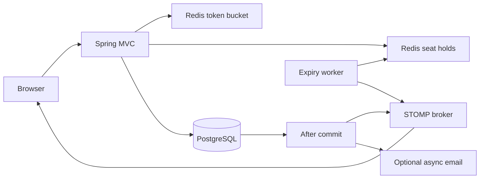

# Architecture

TickIt uses a single Spring Boot application, PostgreSQL for durable bookings, and standalone Redis for short-lived reservations and rate limiting.

## Reservation lifecycle

1. Write requests pass an atomic Redis token bucket. IP buckets have capacity 20 and refill at 5 tokens per second. An optional demo user header adds a user bucket; it is not authentication. The app uses the socket peer IP rather than trusting arbitrary forwarded headers.
2. A Lua script acquires `hold:{eventId}:{seatId}` and records the expiry in a Redis sorted set atomically. Same-owner retries return success without extending the original TTL. Other owners are rejected.
3. Checkout validates the hold, user, and seat/event relationship, then inserts a confirmed booking. PostgreSQL's unique `(seat_id, event_id)` constraint arbitrates competing inserts, including requests that bypass Redis.
4. Transaction synchronization dispatches side effects only after commit. Hold release compares the owner. WebSocket or email dispatch failures are logged and do not change the committed response.
5. An expiry worker checks up to 200 due index entries every second. Redis TTL removes expired holds; the worker broadcasts the current state. Clients reconcile against the API every five seconds and after reconnecting to recover missed or reordered messages.

`@Version` handles optimistic locking on updates to existing booking rows. It does not prevent duplicate inserts; that guarantee comes from the unique constraint.

## Source map

| Package / path | Responsibility |
|---|---|
| `controller/` | REST endpoints |
| `service/` | Booking transaction, holds, expiry, rate limiting, email |
| `model/`, `repository/` | JPA persistence |
| `config/` | MVC, Redis, STOMP, bounded async executor |
| `dto/`, `exception/` | API contracts and HTTP error mapping |
| `resources/db/migration/` | Flyway schema |
| `resources/scripts/` | Atomic Redis Lua operations |
| `resources/static/` | Website, local images, vendored WebSocket clients |
| `src/test/` | Integration and concurrency regression tests |

## Current boundaries

The STOMP broker runs in memory in one application instance. Email is best-effort through a bounded executor. Horizontal deployment requires a shared broker and durable event delivery, such as a transactional outbox. The Redis expiry index targets standalone Redis and is not routed for Redis Cluster hash slots.

Simulated identities are client supplied. Hold-owner checks prevent accidental cross-account releases, but are not an authorization boundary. Add authentication before exposing booking operations publicly. There is no payment flow, cancellation/refund flow, or booking idempotency key. After an uncertain checkout response, consult booking history before retrying.
